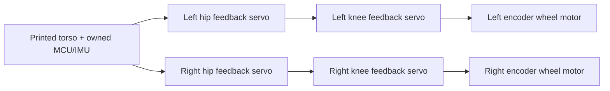

# Miniature wheeled biped — feasibility and development plan

**2026-10-11 · Research proposal, not a CAD, purchasing or print release.**
Owner priority: **$150–250 in new parts**, excluding the printer and already
owned electronics; **balance, drive and actively crouch first**. Preserve two
legs, an independently actuated hip and knee on each, and two driven wheels.
Use the miniature to develop the control and RL workflow before spending more
on the large robot. Current project/print status is in
[PROJECT_STATUS](../../PROJECT_STATUS.md) and [README](../../README.md).

## 1. Recommended direction

Build a new miniature with **four ST3215 12 V feedback servos, two encoder DC
wheel motors, printed links/body/wheels, and a small number of bought bearings,
pins, screws and shaft couplers**. Use the owned Teensy 4.1 and BNO085. Start
with a direct servo at each hip and knee; omit the large R2A crank and pushrod.
The knee servo sits on the upper link, near the knee. This retains independent
hip, knee and wheel control while reducing the mechanisms to characterize.

Proposed sizing inputs are **70 mm between each pair of joint axes, 60 mm wheel
OD and 1.000 kg total mass target**. These are design assumptions, not scaled
R2A dimensions or measured envelopes. Treat **1.200 kg** as a sensitivity case
to investigate, not an accepted weight limit. Packaging may change the link
lengths. No overall height or track width is frozen before Fusion packaging.

This is a plausible platform for stationary balancing, forward/reverse driving,
turning and controlled crouching, followed by RL for those tasks. They remain
**target behaviors**, not demonstrated capabilities of this proposed build.
Jumping, drops, stair climbing, hard landings, single-leg hopping and reliable
stand-up after a fall are outside its initial scope. Ordinary falls are still
a design case: replaceable bumpers and protected actuator mounts matter.

**Cost conclusion:** the specified motor/control products total **$128.45**.
The planning basket is **$227.84** with a new small battery and a reused/borrowed
suitable charger, including unquoted mechanical/printing/delivery allowances.
The new battery-and-charger reference basket is **$266.83**, above the owner's
target. Bench development without either is **$213.45**, conditional on an
appropriate existing supply. The under-$250 route therefore depends on reuse
or verified savings; a complete independent robot for $150 is not established.
Verify an actual delivered basket before ordering the complete set.

## 2. Why the miniature is useful, and what it cannot prove

Keep the large robot's task and joint coordinates; change the actuator and
mechanical implementation. Scaling every original part down would retain
expensive rod ends, interfaces and packaging constraints that the miniature
does not need. Reusing the heavy owned GIM actuators would defeat its mass
target. Keep those intact for the later large build.

For geometrically similar structures of the same density, mass scales with
length cubed and gravitational joint moment with length to the fourth power:
the moment is mass × gravity × lever arm. This explains why short, light legs
can use substantially smaller actuators. Real bought actuators do not scale
geometrically; their fixed mass and gearbox properties must be accounted for.
Smaller size also shortens the gravitational balance time scale. It does not
automatically make the controller easier to tune.

| Work on the miniature | Value to the larger robot |
|---|---|
| IMU/encoder timing, estimation, logging and watchdogs | Reusable architecture and debugging methods; remeasure latency on new hardware |
| Common hip/knee/wheel coordinates and observations | Reusable software interfaces and experiments |
| Balance/drive/crouch curriculum, rewards and evaluation | Reusable training design; tune to the larger dynamics |
| Actuator identification and domain randomization | Reusable process; new actuator models are required |
| Learned miniature policy | Baseline or initialization to investigate; no direct transfer guarantee |
| Joint torque, thermal endurance, gear wear, impact survival | Specific to the miniature; does not release the larger hardware |

The previous servo rejection in the
[large R2A trade study](active_knee_actuator_trade_study.md) concerned a
jump-capable knee at the original mass and load. It does not exclude a newly
sized, balance-and-crouch servo prototype. The miniature's lower-cost actuator
choice buys a different performance envelope.

## 3. Reference designs and actual evidence

These references establish complementary pieces of feasibility. None is a
verified, ready-to-order copy of this exact proposal at the owner's budget.

| Primary reference | What is demonstrated or documented | What to reuse |
|---|---|---|
| [Upkie](https://github.com/upkie/upkie) | Wheeled biped, independent leg joints, balancing examples, common real/simulation Gymnasium interfaces and RL playgrounds | Joint topology, observation/action conventions and baseline balance experiments; its mjbots hardware is outside this budget |
| [Open Duck Mini v2](https://github.com/apirrone/Open_Duck_Mini) | Printed servo biped with real sim-to-real demonstrations, actuator identification and an embedded policy runtime | Evidence that inexpensive servos can support RL when modeled appropriately; this is a footed robot, not a wheel-biped policy or BOM |
| [Rhoban BAM](https://github.com/Rhoban/bam) | Servo identification tools and Feetech STS3215 models, usable in MuJoCo | Start from its fitting method and model structure; identify the delivered servo variant |
| [2Will](https://github.com/colepuls/2Will) | Creator reports PID balance, drive/turn and servo-actuated standing/crouching on a printed wheeled robot | Cheap capability precedent; its reduced leg actuation and feedback do not match our six-actuator research interface; no deployed RL is established there |
| [StackForce Mini documentation](https://wiki.seeedstudio.com/stackforce_mini_wheeled_legged_robot/) | 540 g wheel-legged robot, four leg servos, two gimbal wheel motors, parallel legs, printed structure and metal bearings; balance/height-control tutorials | Compact packaging and the feasibility of mostly printed structure; its leg feedback and closed-chain mechanism differ |

The [complete StackForce kit](https://www.seeedstudio.com/StackForce-Mini-Wheeled-Legged-Robot-p-6710.html)
displayed **$299.00**, above this budget before delivery. Its official tutorial
requires a board-specific registration code when flashing wheel-control
firmware. Examine that dependency before adopting its electronics. Its public
demonstrations do not establish an RL result.

## 4. Actuator and transmission decision

### Leg joints: four ST3215 12 V units

The specific retail candidate is **DFRobot SER0070** at **$19.90 each**, with
horn/screw accessories and a cable listed. Buy the 12 V variant, not a similarly
named 7.4 V model or a different ratio. Its retail rated load is **10 kgf·cm**;
the **30 kgf·cm** headline is stall. The quoted figures and package contents are
from the [retail product page](https://www.dfrobot.com/product-2962.html).

The [Feetech ST-3215-C018 specification](https://www.feetechrc.com/Data/feetechrc/upload/file/20240507/6385067068652648096680943.pdf)
lists **55 ± 1 g**, **45 rpm no-load at 12 V**, **900 mA rated current** and
**2.7 A stall current**. Position feedback uses a magnetic encoder. The
documented modes are position, closed-loop speed, open-loop speed and step.
Use position targets for the joints initially. The listed rated torque needs
confirmation in the actual sustained crouching duty cycle.

Feetech describes the **load register as a drive-duty proxy** and lists current
separately. Do not interpret load as measured joint torque or advertise this
model as a constant-current joint actuator. That distinction determines how
the simulator should respond to commands.
[Manufacturer feedback explanation](https://www.feetechrc.com/2020-05-13_56655.html).

A small supplied spline horn is acceptable for initial fit inspection; the
loaded joint needs a positive, retained torque connection and a separately
supported pivot. If the supplied horn flexes, select a compatible metal horn
and add its actual cost. Do not assume every generic 25T accessory has the same
clearance, screw engagement or idler interface.

### Wheels: two DCGM-3865 encoder motors

The **Waveshare DCGM-3865-12V-EN-240RPM** was indexed at **$9.99 each** on the
official shop. It publishes **4 kgf·cm at 125 rpm**, **≤1 A rated**, **240 rpm
no-load**, **≥8.5 kgf·cm locked-rotor torque** and **≤3.5 A locked-rotor
current** at **12 V**. Its L-shaped reducer is described as non-self-locking;
that does not quantify friction or prove fast reversals.
[Official product/specifications](https://www.waveshare.com/product/accessories/motors-servos/dcgm-3865-12v-en-240rpm.htm).

Use one **Pololu DRV8874 #4035** per wheel. At **$11.94 each**, it provides
adjustable current regulation and analog current feedback. The carrier's
vendor-tested continuous figure is **2.1 A**, with cooling conditions stated on
the page. Start with a proposed **1 A motor-current limit**, then establish the
actual acceleration/thermal envelope. The chip's transient current headline
is not a continuous board rating.
[Driver product and electrical details](https://www.pololu.com/product/4035).

The wheel encoder supports **3.3 V** supply per the
[motor wiki](https://www.waveshare.com/wiki/DCGM-3865-12V-EN-240RPM).
Prefer that interface with the Teensy after checking delivered signal levels.
Treat its encoder as motor-side feedback through a gearbox: wheel backlash,
coupler slip and tire slip are not directly measured. Avoid differentiating a
short fixed-count window into a noisy near-zero speed signal; use timestamped
counts with an estimator suited to low speed.

### Alternatives and rejected savings

| Option | Assessment for this miniature |
|---|---|
| Four standard joints plus two [ST3215-HS wheels](https://www.waveshare.com/product/modules/motors-servos/st3215-hs-servo-motor.htm) | Credible alternate: HS is $21.99, 106 rpm no-load, with continuous velocity mode. Lighter and fewer separate driver parts; similar actuator/control cost. Test loaded reversal and bus latency before selecting it for balance. Keep a replaceable wheel module in the CAD |
| Six standard ST3215 units | Their wheel speed ceiling is low; do not choose this just to standardize parts |
| Two [DRV8876 carriers](https://www.pololu.com/product/4036) | $8.15 each, 1.3 A carrier continuous rating. Possible with active current limits and verified cooling; retain DRV8874 as baseline for headroom |
| [Waveshare encoder N20](https://www.waveshare.com/product/modules/motors-servos/dcgm-n20-12v-en-200rpm.htm) | $6.99, 200 rpm no-load and only ≥1.2 kgf·cm stall; no documented continuous torque point. Small savings do not justify making it the baseline wheel motor |
| Generic PWM hobby servos | Low sticker price, but external sensing adds hardware and the joint response remains poorly specified. A possible reduced demonstrator, not the preferred RL platform |
| [Dynamixel XL330-M288](https://robotis.us/products/dynamixel-xl330-m288-t) | $27.49 with current mode, but the manufacturer lists only 0.52 N·m stall and estimates 0.10 N·m continuous at 5 V. Investigate only for a substantially lighter design, not a drop-in joint substitution |
| [CF35-12](https://www.waveshare.com/product/robotics/cf35-12.htm) | $49.99; [documentation](https://www.waveshare.com/wiki/CF35-12) includes constant-current mode. Four consume most of the budget before wheels/power; high gearbox friction still complicates output torque estimation |
| Bare BLDC + printed reduction + custom FOC | Potential later research, but controller, encoder, reduction, shafts and tuning erase the apparent motor-only saving |
| Printed precision gearbox, printed main pivot pins or printed motor splines | Avoid initially. Purchased servo gearboxes already provide reduction; printed alignment/wear/slip uncertainty adds characterization and repair work |

The DC wheel baseline is a recommendation, not a proven winner. If its moving
mass or stiction prevents the targets, compare the HS wheel sample before
making the legs larger or purchasing more powerful joint servos.

## 5. Sizing screen and its limits

The source for all derived figures here is
[`mini_biped_calc.py`](../../mini_biped_calc.py), with published inputs in
[`vendor_inputs.json`](../../evidence/miniature/2026-10-11_research/vendor_inputs.json).
Run the script to reproduce them; do not substitute the large `r2a_calc.py`
loads. New design choices are explicitly assumptions.

For equal **70 mm** links and a symmetric stance, let β be knee flexion from
straight. With each wheel below its hip and equal load sharing:

`vertical reaction per leg = mg/2`

`knee ground-force moment = (mg/2) L sin(β/2)`

`hip height above floor = 2L cos(β/2) + wheel radius`

This only screens the vertical ground-force contribution. It omits distributed
leg weights, moving inertia, wheel reaction torque, horizontal acceleration,
friction, gear efficiency, compliance and impacts. It is neither a full inverse
dynamics model nor a strength/thermal calculation.

| Assumed total mass | β | Knee moment, two supporting legs | Hip height |
|---:|---:|---:|---:|
| 1.000 kg | 30° | 0.088835 N·m | 165.230 mm |
| 1.000 kg | 90° | 0.242702 N·m | 128.995 mm |
| 1.000 kg | 120° | 0.297248 N·m | 100.000 mm |
| 1.200 kg | 90° | 0.291243 N·m | 128.995 mm |
| 1.200 kg | 120° | 0.356698 N·m | 100.000 mm |

The joint's published rated torque converts to **0.980665 N·m**. Use
**0.490333 N·m**, half of that figure, as an unvalidated planning target for
sustained static demand. At the 1.200 kg / 120° sensitivity point, twice the
vertical load or single-leg support gives **0.713396 N·m**, already beyond that
planning target. This is a reason to begin with both wheels supported and slow
crouching; it does not establish a dynamic safety factor.

Hip demand cannot be inferred from knee demand. The centered symmetric model
has zero hip moment from vertical ground force, but moving a wheel **40 mm**
from the hip at **1.200 kg** gives **0.235360 N·m** from that force alone.
Check every commanded pose and acceleration in the complete later model;
never permit the full geometric range simply because the knee static screen
passes. Avoid exact straight-leg locking and folded singular poses.

For the proposed **60 mm** wheel OD, surface-speed calculations are:

| Actuator working point | Calculated wheel surface speed |
|---|---:|
| Standard ST3215, 45 rpm no-load | 0.141372 m/s |
| ST3215-HS, 106 rpm no-load | 0.333009 m/s |
| DCGM-3865, 125 rpm published rated point | 0.392699 m/s |
| DCGM-3865, 240 rpm no-load | 0.753982 m/s |

These are kinematic conversions, not loaded robot speed or balance-recovery
ratings. The rated wheel torque converts to **0.392266 N·m**. Both direction
reversal performance and usable speed under acceleration still need tests.

The tentative mass allocation is **0.944 kg**: four nominal servo masses,
two wheel shop-listing weight proxies, and assumed allowances for prints,
battery, electronics/wires and metal hardware. **The wheel listing does not
identify net mass.** Weigh the sample and bought parts before packaging is
frozen; that proxy is not a motor measurement or a guaranteed upper bound.

## 6. Mechanism and printed-part changes

| Part/function | Miniature implementation | Why |
|---|---|---|
| Torso | Printed open frame with removable electronics/battery tray | Low part count; access to wiring and measured component locations |
| Hip | Body-mounted feedback servo; upper link attached through retained horn; opposite pivot supported | Servo applies torque; avoid making its output the entire cantilever load path |
| Knee | Feedback servo near the knee on upper link; supported lower-link yoke | Eliminates pushrod, spherical ends, crank/lever caps and linkage transmission calibration |
| Thigh/shank | Short, ribbed printed links and replaceable actuator mounts | Accessible fasteners and inexpensive replacements after a fall |
| Wheel | Printed rim/hub, bought shaft coupling, replaceable tire | Reliable motor connection and repeatable friction surface |
| Wheel shaft support | Bearing-supported extension or outboard support, as the actual drawing permits | Avoid an unchecked wheel overhang on a small gearbox shaft; check alignment and service path |
| Stops | Replaceable printed stops with compliant bumpers outside normal commanded travel | Fault containment; do not use them as routine impact absorbers |
| Sensors | Joint feedback, two wheel encoders and torso-mounted IMU | Observe the actual six actuator states and base motion |

Keep **bearings/bushings, pivot pins or shoulder screws, retaining hardware,
screws/nuts and shaft couplers** off the printer. A bearing costs little
relative to a stripped servo gearbox. Do not require machining: use stocked
shaft sizes and shoulders. Use through-bolts/captive nuts where practical to
reduce new insert purchases. Ordinary screw threads should not serve as the
rotating bearing surface.

Small **625/626 bearing families are candidates**, not frozen selections.
Select the actual idler shaft, support span, shoulder and bearing drawing
together after inspecting the servo and wheel hardware. The cost allowance is
not an audited bearing count. Do not copy the large robot's 6800 seats, pin
diameters, interference fits or old ABS compensation into the new material.

The starting structural material candidate is **unfilled PETG**, with an exact
brand/profile to be selected before coupons. PLA can be useful for unpowered
geometry trials. TPU tires are attractive if already on hand; otherwise price
a stocked rubber tread/O-ring solution rather than silently adding a spool.
Material choice is not a strength release. The
[Bambu comparison](https://us.store.bambulab.com/collections/bambu-lab-3d-printer-filament/products/petg-hf?from=home_web)
also illustrates why generic material labels are insufficient: stiffness and
impact properties vary by formulation and print axis. Do not treat PETG HF,
ordinary PETG and an arbitrary Amazon spool as interchangeable data.

Proposed print design rules:

- Put bearing/pin axes normal to the bed where the mating coupon permits it;
  design flat supporting faces and split yokes instead of printing unsupported
  precision bores sideways.
- Orient link load paths in the layer plane, use ribs and generous transitions,
  and keep screw clamping away from thin unsupported walls. Resolve any conflict
  with the precision-axis rule in Fusion and a dedicated coupon.
- Keep supports off bearing seats, horn mating faces and service surfaces;
  audit removal and shaft insertion with the real hardware envelope.
- Preserve the pass/fail coupon philosophy: no drilling, filing or pulling a
  bad fit together with screws. Release compensated geometry deliberately.
- All CAD inspection, construction, assembly-path checks and exports go through
  Fusion MCP in a **new document**. Existing R2A and legacy documents remain
  separate. This research generated no CAD, STL or released orientation.

The existing ABS restrictions remain in force. Do not use the assembled ABS
article or ABS stand for torque testing or ground experiments. Proposed powered
miniature ground tests require a separately verified structural material,
load path and commissioning envelope; this document does not release them.

### Why not keep the full R2A linkage?

Its main benefit is moving knee-actuator mass toward the hip. In this miniature,
first see whether the small knee servo's moving mass is acceptable. A direct
knee removes several interfaces and lets joint feedback correspond directly
to the knee angle. Keep the hip-coaxial crank concept as a later comparison if
identified moving inertia is the limiting factor.

A body-mounted **five-bar** leg is a viable alternate, evidenced by parallel-leg
robots above. It retains two leg motors per side but adds passive pivots,
closure constraints, singularities and alignment work. It does not save motors
while retaining independent fore/aft and height motion. A **one-servo-per-leg**
linkage saves actuators by constraining the wheel path, but removes independent
hip/knee commands. Use that only if the full six-actuator budget fails and the
owner accepts the reduced research problem.

## 7. Costed basket and procurement strategy

**Lookup date: 2026-10-11. USD.** DFRobot/Pololu/GensTattu prices were readable live;
Waveshare shop prices/specifications were available from indexed official
pages while direct fetches were blocked. None is a checkout quote, delivery
promise or confirmation of identical stock variants. The price/source record
is [vendor_inputs.json](../../evidence/miniature/2026-10-11_research/vendor_inputs.json).

| Product | Qty | Unit | Extended |
|---|---:|---:|---:|
| [ST3215 12 V, SER0070](https://www.dfrobot.com/product-2962.html) | 4 | $19.90 | $79.60 |
| [DCGM-3865 encoder wheel motor](https://www.waveshare.com/product/accessories/motors-servos/dcgm-3865-12v-en-240rpm.htm) | 2 | $9.99 | $19.98 |
| [DRV8874 carrier #4035](https://www.pololu.com/product/4035) | 2 | $11.94 | $23.88 |
| [Bus Servo Adapter A](https://www.waveshare.com/product/modules/motors-servos/bus-servo-adapter-a.htm) | 1 | $4.99 | $4.99 |
| **Motor/control product subtotal** | | | **$128.45** |
| Bearings, pins, couplers, fastener top-ups — **allowance** | | | $20.00 |
| Power distribution, logic interface and protection — **allowance** | | | $15.00 |
| Filament cash purchase — **allowance** | | | $20.00 |
| [Tattu 850 mAh 3S XT30 battery, price reference](https://genstattu.com/tattu-850mah-11-1v-45c-3s1p-lipo-battery-pack-with-xt30-plug.html) | 1 | $14.39 | $14.39 |
| [iMars Mini + power adapter, price reference](https://genstattu.com/gens-ace-imars-mini-g-tech-60w-rc-battery-charger-with-usb-c-power-supply-adapter/) | 1 | $38.99 | $38.99 |
| Tax, shipping and contingency — **allowance** | | | $30.00 |
| **Full-new reference basket, with allowances** | | | **$266.83** |
| **Reuse/borrow suitable charger; other rows retained** | | | **$227.84** |

The initial battery/charger allowance was too optimistic and is replaced here
by sourced price references. The charger/pack pair is not approved hardware:
check adjustable charge current against the chosen pack and price required
balance/main-lead adapters. Existing charger ownership is unconfirmed. To keep
new spending within $250, first seek a suitable borrowed/reused charger or
confirmed stock/supplier savings. Do not quietly accept the full-new basket as
meeting the target. Very cheap E3 chargers appeared in searches, but the
[manufacturer's model is discontinued](https://www.skyrc.com/e3_Charger);
that listing does not establish a currently procurable alternative.

The MCU, IMU, tools, existing assorted fasteners/wire and a training computer
are assumed available. Their ownership is documented in
[electronics BOM Wave 0](../../electronics/07_bom.md); inventory exact counts
before buying. The bench PSU's receipt is not confirmed. A new PSU, computer,
GPU, paid cloud training, separate TPU spool or spare actuator is **not** in
this basket. A required missing item or expensive delivery can break the cap.
If it does, reduce/defer purchases explicitly; do not remove feedback sensing
or power protection to make a misleading total.

The **$213.45** basket without battery/charger is a bench-development scenario
only, conditional on an appropriate existing supply. A power tether changes
the dynamics and cannot validate free driving or a final policy. A small
battery should eventually be carried and modeled at its real location.

**Amazon strategy:** use it preferentially for standard bearings, couplers,
fasteners and filament when the landed basket is better. For actuators, match
the exact voltage/ratio/encoder/SKU and seller. A
[Waveshare-branded ST3215 listing](https://www.amazon.com/dp/B0B6P9271Q)
was found, but its observed offer/delivery data were not reliable enough to
use as the budget quote. Current Amazon wheel offers were not verified.
Brand text does not establish seller provenance. Avoid a generic “N20” or
“JGA25” listing without the torque/current/encoder data needed to identify it.
Maker-direct motor purchases plus Amazon commodity hardware may cost less than
insisting on an all-Amazon robot.

Recommended first sample basket: **one joint servo, one wheel motor, one wheel
driver and the adapter: $46.82 product subtotal**. Delivery and any fixture/
interface parts are additional, and these samples count toward the final robot.
Characterize them before buying the remaining motors. No parts were ordered
by this study.

## 8. Electronics, power and real-time control

Reuse the Teensy/BNO085 and the existing logging work. The CAN transceivers
remain for the larger robot; this miniature uses a half-duplex servo UART and
two brushed-motor driver channels. Keep the Stage 0 scaffold intact and put
miniature command firmware in its own target after the hardware is selected.

Proposed rates, all **unverified design choices**:

| Function | Starting target | Validation needed |
|---|---:|---|
| MCU acquisition, state estimate and wheel balance | 500 Hz | Worst-case execution, IMU report age, encoder service and watchdog margin |
| Four joint commands/feedback transactions | 100 Hz | Complete bus round-trip with delivered servos, jitter and dropped packets |
| RL policy | 50 Hz | Model size/inference time and observation-to-action delay on actual compute |

Separate the fast local loop from USB/Wi-Fi and policy execution. Use the
lowest-latency validated raw IMU path and local fusion rather than importing
an old on-chip fusion delay assumption. A 1 Mbps UART headline does not prove
the servo's loaded response or a synchronized six-actuator update. Configure
IDs individually and verify signs, zeros, travel limits and freshness flags.

Power concept: **12 V bench characterization**, then a suitable **3S pack**
with **12.6 V maximum**, conditioned logic rail and common signal ground.
All vendor performance figures above are at 12 V; a battery's sag/lower voltage
changes speed and available torque. Select the actual pack, connector,
charger, undervoltage handling and wiring before the mobile commissioning gate.
Do not connect the existing 20 V motor bus to these servos.

Use fused, adequately rated branches for servos and wheel drivers, with a
physical power disconnect, voltage monitoring and accessible motor-current
measurement. The [adapter FAQ](https://docs.waveshare.com/Bus_Servo_Adapter_A/FAQ)
limits its power path to **5 A** and states it has no onboard regulator. Four
joint stall currents already sum to **10.800 A**; all six published stall-current
figures sum to **17.800 A**. These sums are fault-screening inputs, not a demand
for continuous stall operation or a power-supply selection. Keep bulk actuator
current out of the bridge PCB and a single servo cable chain; design separate
power injection and signal wiring from the actual schematic.

Check the UART bridge's **MCU-side logic levels** and buffering before wiring
the Teensy; USB setup alone does not prove direct UART electrical compatibility.
Likewise, scale the driver's analog current signal so it cannot overrange the
MCU ADC. Account for those interface parts in the power/electrical allowance.
Size decoupling and regenerated-energy handling for braking; a bench PSU is not
automatically a sink, and a fully charged battery is not unlimited absorption.
Choose and validate the clamp/sink arrangement before dynamic reversals.

A stale host/policy command, stale IMU, invalid joint feedback, overtemperature
or undervoltage must produce a bounded local stop and a **latched fault**.
Do not rely on a servo's automatic protection/restart behavior to supervise the
robot. Establish the timeout and stop behavior experimentally in the supported
fixture; balance and complete power removal have different consequences.

## 9. RL plan that matches the hardware

Start with a classical balance controller as an engineering baseline. Lock the
leg *commands* to a validated bent pose, then add slow hip/knee coordination
that keeps each wheel under its hip during crouching. Balance gains or models
will depend on leg configuration. The robot should first be an observable,
repeatable control system; RL is the next experiment, not a substitute for
fixing missed packets or loose couplers.

For the initial six-action RL interface use **four joint position targets plus
two signed wheel PWM/voltage commands**, bounded by local limits. Simulate the
joint's internal position controller and the wheel's brushed-motor/gearbox
response. If wheel velocity targets are selected instead, include that exact
local speed loop in both simulation and deployment. Do not train ideal joint
torques and feed them to position servos.

Observations should include base orientation/gyro, measured joint positions
and estimated rates, wheel positions/rates, command history and measurement
ages. Log supply voltage, currents, temperatures and faults even if they are
not all policy inputs. Establish consistent units and signs before writing
rewards. A single torso IMU does not measure every link's deflection or ground
contact directly; model those limitations.

Development sequence:

1. **Identify actuators.** Record unloaded and supported loaded trajectories,
   delay, speed/acceleration saturation, position error, backlash/deadband,
   wheel friction and reversals, voltage dependence and thermal drift. Use
   BAM's STS3215 work as a starting point; batch and mounting differences
   still need fitting.
2. **Build the measured robot model.** Generate geometry/mass/inertia evidence
   through Fusion MCP, then create a small MuJoCo model. Replace tentative mass
   allocations with weighed parts. Include wheel contact, backlash/friction,
   sensor/command delays, saturation and the actual command semantics.
3. **Train a narrow task.** Fixed-height stationary balance first; then drive
   tracking and steering; then a limited height/crouch command. Do not begin
   with jumps or automatic fall resets on physical hardware.
4. **Randomize plausible uncertainty.** Friction, backlash, controller gains,
   delays, supply voltage, mass and tire contact should vary over measured or
   explicitly justified ranges. Randomization cannot rescue an incorrect
   actuator type or an absent observation.
5. **Deploy with the local supervisor.** Initially use an existing computer
   over a supported/tethered link while the MCU handles timing and faults.
   Later try a small compiled policy on the Teensy, subject to an inference
   benchmark, or an owned SBC. Do not add a Pi/Jetson purchase by default.
6. **Compare against the baseline.** Measure tracking error, falls, operating
   time before thermal limits, saturated-command fraction and dropped/stale
   updates. Begin residual-policy experiments around the baseline before
   investigating a fully learned local balance law.

Training is offboard. A simple CPU-based balance task is a sensible starting
point; large parallel training has a separate compute budget. Upkie provides
both CPU balance and GPU whole-body examples, but its robot models/drivers
need adaptation. Imported source/assets require their license/attribution to
be preserved; this study copied no third-party CAD or control code.

## 10. Staged work and decision gates

| Stage | Work and concrete evidence | Spending/decision |
|---|---|---|
| A — selection and inventory | Confirm owned MCU/IMU, supply, fasteners, filament/tread; quote the complete basket; identify exact variants and obtain drawings | Hold further large R2A purchases; no complete miniature order until the cap is credible |
| B — sample and unpowered packaging | First sample basket; electrical/no-load checks; new Fusion document with measured interfaces, wire access, joint support, wheel coupler and insertion/removal paths | Defer remaining actuators pending Stage C sample characterization |
| C — coupon and actuator characterization | Same-material/same-axis fit coupons; verified miniature fixture/load path; sustained supported joint load and wheel reversal tests with temperatures, timestamps and current limits | Buy remaining actuators only if measured behavior/mass and landed price support the proposal; reject/resize a failed envelope |
| D — one supported leg | Release actual orientations/meshes through Fusion; hand sweep first, then bounded wheel-clear hip/knee motion and wheel drive | Confirm no bind, loosening, cable catch, driver overheating or unexpected restart |
| E — two-leg balance baseline | Verified structural material and complete load/dynamics model; protected low-speed commissioning in a clear test area; fixed bent pose before active crouch | Release only the observed envelope; stop if near-continuous saturation or uncontrolled oscillation occurs |
| F — measured sim-to-real | Fitted model, deterministic logs, simulated baseline, RL curriculum, held-out policies and bounded deployment | Preserve reproducible experiments useful to the larger project |

Before a physical stage, its commissioning document must specify measured
temperature/current/angle/speed limits, stop behavior and the acceptance run.
This proposal deliberately supplies no untested “safe” fall height, payload,
runtime, jump height or commanded loaded speed. CAD and physical acceptance
use the project's [assembly-verification gate](../../ASSEMBLY_VERIFICATION.md).

If the mass target fails, reduce printed mass, relocate electronics and compare
wheel modules before increasing joint size. If the all-in basket exceeds the
cap, consolidate suppliers/reuse confirmed stock or defer battery development;
reduced actuation is a separate scope change, not a silent substitution. If
both wheel candidates show excessive lag/stiction, revisit the wheel drive
rather than spending on the remainder of an unsuitable set.

## 11. Unresolved evidence and follow-up

| ID | Unresolved item | Required resolution |
|---|---|---|
| MINI-1 | Encoder revision: current DCGM pages give 13 × 42 = 546 basic pulses; an [older Waveshare manual](https://m.media-amazon.com/images/I/81B0BQEdwEL.pdf) gives 11 × 42 = 462 | Count delivered output revolutions and document x1/x2/x4 convention; do not silently select one |
| MINI-2 | Wheel shop weight does not distinguish net/packed mass | Weigh sample, then revise mass/inertia budget |
| MINI-3 | ST3215 internal motor/gear descriptions differ across manufacturer/retail revisions | Record actual SKU/batch and interfaces; do not infer coreless motor or steel gears from the name |
| MINI-4 | Joint sustained duty, backlash and loaded response; wheel reversal/stiction | Recorded sample characterization in a verified miniature fixture |
| MINI-5 | Delivered basket, charger access, missing PSU/filament/tire stock and exact connector/interface parts | Inventory and quotes before whole-set purchase; $227.84 reuse scenario remains conditional; full-new reference is $266.83 |
| MINI-6 | PETG formulation, structural load cases, joint support and print orientation | Separate Fusion/physical release; existing ABS limits are unchanged |
| MINI-7 | Full servo-bus timing, bridge voltage levels, fault/restart behavior and regen | Electrical design review and instrumented checks before ground commissioning |
| MINI-8 | Policy inference time and training host availability | Benchmark owned hardware; revise compute plan explicitly if it fails |

Recommended next action is **Stage A/B around the sample set and a separate
miniature Fusion skeleton**, retaining all six independent actuators. It is
the cheapest useful experiment for deciding whether to commit the full budget.
